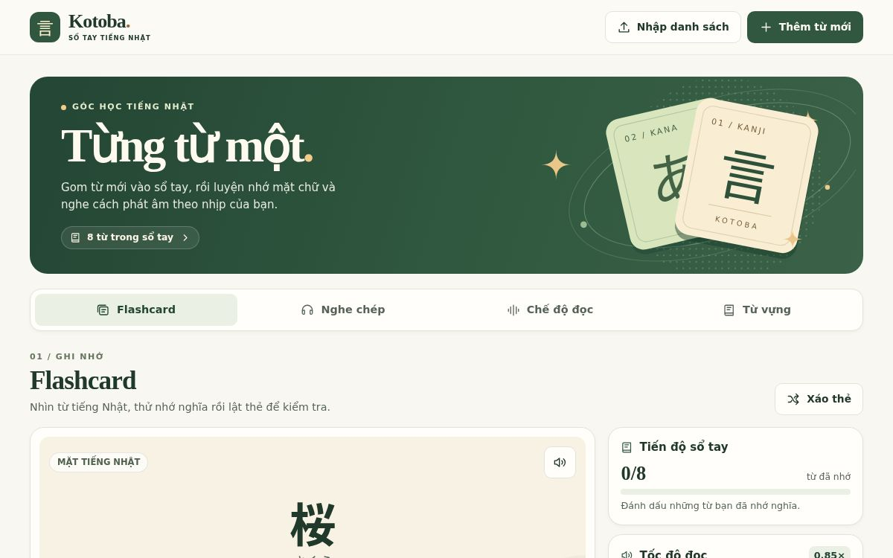

# Kotoba · Sổ tay từ vựng

Trang học từ vựng tiếng Nhật bằng tiếng Việt. Trang có 8 từ mẫu và chạy bằng HTML, CSS và JavaScript thuần.



## Clone và chạy trên máy

Cần có Git và Python 3. Mở PowerShell, Git Bash hoặc Terminal và chạy:

```sh
git clone https://github.com/MihQuannn7799/learn-japanese-new-word.git
cd learn-japanese-new-word
python -m http.server 8000 --bind 127.0.0.1
```

Mở [http://localhost:8000](http://localhost:8000) trong trình duyệt. Nếu máy dùng lệnh `py` (Windows) hoặc `python3` (macOS/Linux), thay `python` bằng lệnh tương ứng. Giữ cửa sổ terminal mở trong lúc học và nhấn `Ctrl+C` để dừng máy chủ.

Nếu đã clone repo trước đây, chạy `git pull` trong thư mục dự án để cập nhật. Trang chạy trực tiếp từ mã nguồn, không cần cài thư viện hay đăng nhập. Nếu có Node.js, bạn cũng có thể dùng `npm start` khi máy nhận lệnh `python`.

## Cách học

- **Flashcard** · Xem chữ Nhật, lật thẻ để xem nghĩa và đánh dấu từ đã nhớ. Dùng mũi tên để chuyển từ.
- **Nghe chép** · Chọn **Nghe cả danh sách** để phát từng dòng từ trên xuống. Bấm biểu tượng loa để nghe một dòng đúng một lần, gõ kana hoặc kanji và chọn **Kiểm tra**. Có thể xem đáp án ở từng dòng.
- **Chế độ đọc** · Bấm chữ Nhật hoặc chọn một dòng để nghe từ một lần ở tốc độ 1×. Chọn **Tự đọc từ** hoặc **Tự đọc từ + câu** để phát liên tiếp từ vị trí đang chọn. Có thể nghe câu riêng và bật/tắt cách đọc hoặc nghĩa tiếng Việt.
- **Cài đặt danh sách** · Chỉnh tốc độ (0,5×–1,5×), số lần đọc mỗi từ (1–5) và khoảng nghỉ giữa hai từ (0–5 giây). Khi đọc kèm câu, mỗi câu ví dụ được phát một lần sau các lượt đọc từ. Dòng chưa có câu vẫn phát từ bình thường.
- **Từ vựng** · Tìm theo kana, nghĩa hoặc kanji. Bạn có thể thêm, sửa, xóa hoặc nhập nhiều từ cùng lúc. Khi thêm hoặc sửa từ, có thể nhập câu ví dụ và bản dịch.

## Nhập danh sách

Dán danh sách hoặc chọn một tệp UTF-8 `.csv`, `.tsv` hay `.txt`. Mỗi dòng theo thứ tự **kana, nghĩa tiếng Việt, kanji**. Cột kanji không bắt buộc.

```text
つき | mặt trăng | 月
いぬ | con chó | 犬
パン | bánh mì
```

Có thể dùng dấu phẩy hoặc tab thay dấu `|` cho cả danh sách. Nếu nghĩa có dấu phân cách, đặt nghĩa trong ngoặc kép. Trang báo dòng lỗi trước khi lưu và bỏ qua các mục trùng.

Từ vựng, dấu đã nhớ, cài đặt phát và tùy chọn hiển thị được lưu trong trình duyệt theo địa chỉ trang. Tính năng nghe dùng giọng đọc tiếng Nhật mà trình duyệt cung cấp. Nếu trang báo thiếu giọng Nhật, hãy thêm giọng tiếng Nhật trong cài đặt đọc văn bản của thiết bị rồi tải lại trang.

## Mã nguồn và kiểm thử

- `index.html`, `icons.svg` và `css/` chứa khung trang, biểu tượng và kiểu giao diện.
- `js/views/` chứa bốn chế độ học. `js/lib/` chứa logic chuẩn hóa kana và nhập danh sách. Từ mẫu nằm trong `js/data/starter-words.js`.
- `npm test` chạy kiểm thử bằng Node.js 22 trở lên. `npm run build` chép tệp cần phục vụ sang `dist/` để triển khai. Các lệnh này không cần cài thư viện.

## GitHub Pages

Để xuất bản demo công khai, chọn **Settings → Pages → Source → GitHub Actions** trong repo, rồi chạy **Actions → Publish Kotoba to GitHub Pages → Run workflow** trên nhánh `main`. Sau khi thiết lập, các lần push lên `main` chạy kiểm thử và cập nhật bản demo. GitHub hiển thị URL trong **Settings → Pages** sau khi triển khai thành công.

## Giấy phép

Mã nguồn dùng [giấy phép MIT](LICENSE).
